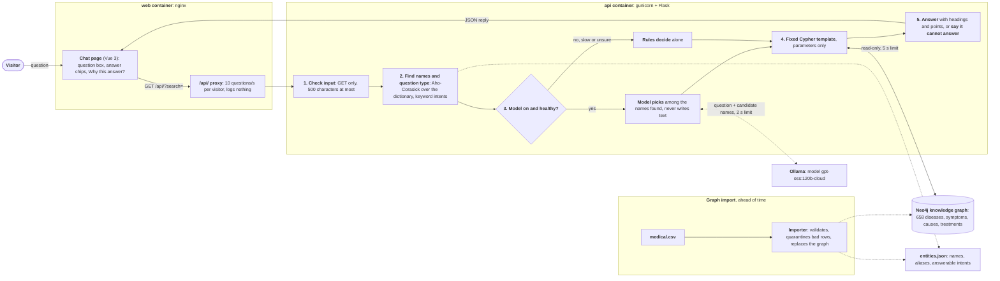
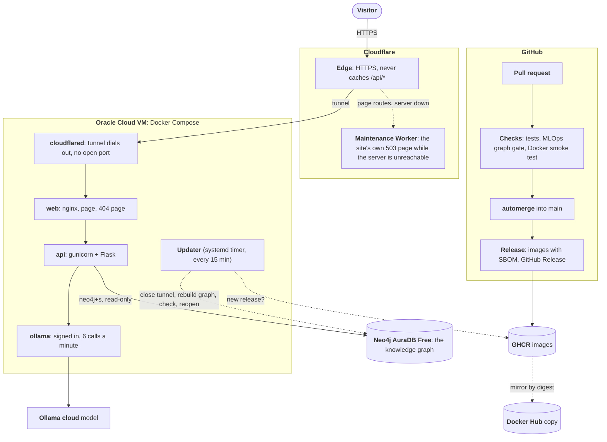

# Medical-ChatBot

This is a student prototype for local use. It is not medical advice and is not built for public deployment.

Mr. Healthcare answers basic questions about 658 diseases and their symptoms (symptoms, causes, prevention, treatments, complications, descriptions) from a Neo4j knowledge graph, and says plainly when it cannot answer. A Vue 3 page talks to a Flask API. The API finds disease and symptom names with an Aho-Corasick automaton and answers only through fixed, parameterized Cypher queries. A language model (`gpt-oss:120b-cloud` through a local Ollama) may read each question to understand it better, but it only chooses among the names the rules found and never writes an answer; when it is unavailable, slow or unsure, the rules answer. Long answers are shown with their own headings and numbered points, and more conversational rewordings are served only after the owner approves each one against the original.

## System Design

What happens to one question. Solid arrows are the path every question takes; dotted arrows are optional or happen ahead of time.



1. The visitor types a question; the page sends it to `/api/`, where nginx limits how fast one visitor can ask.
2. The API checks the input, then finds the disease and symptom names and the kind of question (symptoms, causes, treatments and so on) from fixed rules.
3. If the language model is switched on and healthy, it may only choose among the names the rules found; when it is off, slow or unsure, the rules decide (D-027).
4. The choice becomes one fixed, parameterized, read-only Cypher query; the model never writes a query or an answer.
5. The graph's facts come back as the answer. With no facts, or a question it does not support (such as "how long until I'm cured"), the bot says plainly that it cannot answer.

The graph and the dictionary are built ahead of time: the importer validates `medical.csv`, replaces the graph and writes `entities.json`. Module detail is in [docs/ARCHITECTURE.md](docs/ARCHITECTURE.md), each step's functions in [docs/FLOW.md](docs/FLOW.md).

## Solution Architecture

How the code becomes the public site at https://medical.hamzaaziz.dev. Left: build and release on GitHub. Middle: the internet edge. Right: the server and the managed services it uses.



1. **Build and release.** Every change arrives as a pull request. Path-filtered checks (unit tests, the MLOps graph gate, a full Docker Compose smoke test) must pass before `automerge.yml` merges it; `autorelease.yml` then publishes a versioned release with images on GHCR, copied to Docker Hub (D-019, D-030).
2. **Visitor to server.** The visitor reaches Cloudflare over HTTPS. Cloudflare forwards through a tunnel that the VM opens outward, so the VM has no application port open to the internet (D-032).
3. **On the VM.** nginx serves the page and passes `/api/` to the Flask API, which reads the graph on Neo4j AuraDB and, for understanding only, asks the language model through the stack's own Ollama (D-033).
4. **Updates.** Every 15 minutes the updater checks for a newer release. If there is one, it closes the tunnel, rebuilds the graph with the new image, checks that the site answers, and reopens; on failure it rolls back to the previous release.
5. **While closed or down.** A Cloudflare Worker shows the site's own "being updated" page instead of Cloudflare's error; questions (`/api/*`) never pass through it (D-035). A page already open shows its own maintenance view, then reloads into the new release and keeps the conversation (D-037).

The same images also run on one machine with `compose.yaml` and a local Neo4j container (see [Docker](docs/guides/DOCKER.md)). Setup of the hosted site: [hosting/oracle/README.md](hosting/oracle/README.md).

## Quick start

Run the whole stack on one machine with Docker Compose:

```
cp .env.example .env                              # then set NEO4J_PASSWORD in .env
docker compose up -d --wait neo4j
docker compose --profile init run --rm importer   # builds the graph; again only when the data changes
docker compose up -d
```

Open http://127.0.0.1:8080. The language model is on by default and needs a signed-in Ollama on this machine; without one, or with `LLM_UNDERSTANDING=off`, the rules answer alone. To run from source instead, follow [Local setup](docs/guides/SETUP.md).

## Documentation

| Guide                                                        | What it covers                                                                                                         |
|--------------------------------------------------------------|------------------------------------------------------------------------------------------------------------------------|
| [Local setup](docs/guides/SETUP.md)                          | Python and Node setup, configuration variables, running the API and the page, tests, graph import rules, data provenance, logging |
| [Docker](docs/guides/DOCKER.md)                              | The Compose stack, backups and rollback, automatic updates on a Windows machine, the smoke test                        |
| [Runtime behavior](docs/guides/BEHAVIOR.md)                  | What the API accepts and returns, abstentions, follow-ups, the language-model switch, answer formatting and rewordings, the page during updates |
| [CI/CD and MLOps](docs/guides/CI-CD.md)                      | The workflows, automatic merging, the MLOps gate, releases, Docker Hub and hosting                                     |
| [Offline scripts and experiments](docs/guides/OFFLINE.md)    | The language-model evaluation and rewording scripts, the historical training notebooks                                 |
| [Hosting](hosting/oracle/README.md)                          | Setting up the public site on Oracle Cloud behind Cloudflare                                                           |
| [Architecture](docs/ARCHITECTURE.md), [Flow](docs/FLOW.md)   | Modules and what they own, trust boundaries, and the functions each request passes through                             |
| [Changelog](CHANGELOG.md)                                    | Every release and the pull requests it contains, newest first                                                          |

The `docs/` folder follows the "Defend What You Ship" field guide. Start with [docs/HANDOVER.md](docs/HANDOVER.md) (where things stand) and [docs/CONSTRAINTS.md](docs/CONSTRAINTS.md) (rules for changes). It also holds the decision log, rejected alternatives, architecture, request flow, threat and failure maps, data structures, test checklist, rollback plan, open assumptions, dependency and secrets log, and a one-page defense brief.

## Known limitations

- **Training reproducibility.** The notebook fits its tokenizer before splitting the data, does not seed the split, and has no separate test set. Fixing this needs the training data, the GloVe embeddings and a new evaluation run, so it has not been done.
- **Language model.** It runs by the owner's decision before meeting its pre-registered bar: on a fresh set it understood far more phrasings and added no wrong-subject answer the rules do not also give, but missed the reliability (98.1% usable replies) and latency (p95 1.56 s) targets. Real questions go to Ollama's cloud while it is on; set `LLM_UNDERSTANDING=off` to keep them on this machine.
- **Access control.** The API has no authentication (D-013 in `docs/DECISIONS.md`). It answers read-only questions over public data and listens on this machine only; in Docker, nginx limits each client to 10 questions per second. Putting it on the internet would need real authentication and HTTPS first.
