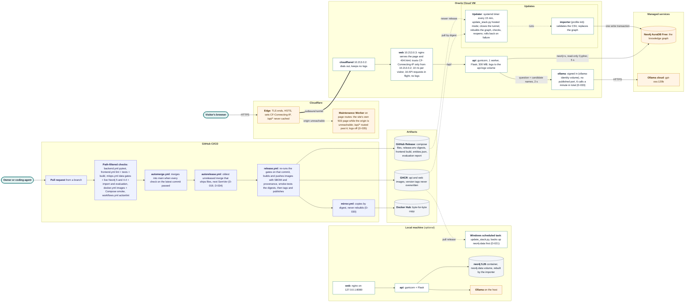

# ARCHITECTURE

One-page map. Deeper detail: the README and its diagrams, the guides in [guides/](guides/), [FLOW.md](FLOW.md), [DATA.md](DATA.md) and the two architecture pages (Solution Architecture and Software & System Design).

## What it is

A rule-based medical question-answering chatbot. It finds disease and symptom names in a question, works out what is being asked from keywords, and answers from a Neo4j knowledge graph built from `api/data/medical.csv`. If it cannot answer from the graph, it says so instead of guessing. There is no machine-learning model at runtime.

## Solution architecture

The whole solution: how a change is checked and released, where the released images and files live, and how they run on the public site and, optionally, on one machine. The README has a simpler version.



- **Colours:** pale teal for actors, blue for CI/CD workflows, white for containers and processes, grey for stored artifacts and volumes, orange for services run by others (Cloudflare, Neo4j AuraDB, Ollama's cloud).
- **Lines:** solid lines carry requests and data, the thick line is the Cloudflare tunnel, dotted lines are the update and fallback paths.
- **Reading order:** left to right, a change goes from the owner through GitHub's checks and release to the artifacts; the updaters on the VM and on a local machine pull those artifacts. A visitor enters through Cloudflare; the VM reaches out only to the managed services.
- **Trust boundaries:** the internet ends at Cloudflare; the VM accepts only the tunnel that cloudflared opens outward; nginx believes `CF-Connecting-IP` only from cloudflared's fixed address; questions leave the VM only to the model, and only the graph's facts reach a visitor. Details in [THREAT.md](THREAT.md).
- **Decisions:** delivery D-019, D-030, D-034; hosting D-032, D-033; the maintenance page D-035; an open page during updates D-037; the local updater D-021 ([DECISIONS.md](DECISIONS.md)).

## Modules and what they own

| Module                                                          | Owns                                                                                                                                                                 |
|-----------------------------------------------------------------|----------------------------------------------------------------------------------------------------------------------------------------------------------------------|
| `frontend/` (Vue 3, Vite)                                       | The page: chat panel and About panel. Talks to the API through `src/chatApi.mjs`; follows updates through `src/liveUpdate.mjs` (D-037).                                                                                    |
| `api/main.py`                                                   | The HTTP boundary: CORS, input limits, JSON errors, request logging without questions. No authentication (D-013).                                                    |
| `api/chatbot_graph_logic.py`                                    | One question in, one answer or abstention out.                                                                                                                       |
| `api/question_classifier.py`                                    | Entity matching (Aho-Corasick over `api/dictionary/entities.json`) and keyword intents.                                                                              |
| `api/question_parser.py`                                        | Turning intents and entities into parameterized Cypher templates.                                                                                                    |
| `api/answer_searcher.py`                                        | Running the queries (read routing, timeout) and wording the answers.                                                                                                 |
| `api/text_format.py`                                            | Headings and numbered points found in long text without changing a word (D-028); the prose projection and formatter identity for rewordings (D-029).                 |
| `api/understanding.py`                                          | The language-model contract (D-027): candidates, frozen prompt, validator, bounded transport, attempt budgets, breaker.                                              |
| `api/database.py`                                               | `.env` loading, Neo4j connection settings and validation.                                                                                                            |
| `api/build_medicalgraph.py`                                     | Validating the CSV and replacing the importer-owned graph snapshot; publishing `entities.json`.                                                                      |
| `api/app_logging.py`                                            | One rotating log file per module.                                                                                                                                    |
| `scripts/llm_understanding.py`, `scripts/reword_answers.py`     | Offline only: the language-model evaluation rounds (D-026, D-027) and the reviewed rewording pipeline (D-029).                                                       |
| `scripts/mirror_release.py`, `.github/workflows/mirror.yml`     | Copies each published release's GHCR digests to Docker Hub, never rebuilding or overwriting (D-030).                                                                 |
| `hosting/oracle/`, `scripts/hosted_check.sh`                    | The public hosted stack (D-032): its compose file, released as `compose.hosted.yaml`; the updater's systemd units; the setup guide; the CI check of its proxy trust. |
| `scripts/evaluate_kg.py`, `eval/`                               | The MLOps gate: graph integrity and behavioural evaluation.                                                                                                          |
| `docker/`, `compose.yaml`                                       | Images and the local stack (nginx web, gunicorn API, Neo4j).                                                                                                         |
| `.github/workflows/`                                            | Path-filtered CI, MLOps, Docker checks, automatic merging, tag-gated release.                                                                                        |

## Data flow and trust boundaries

```
Browser ──(1)──> nginx web :8080 ──/api/──> gunicorn + Flask API ──(2)──> Neo4j
                                               │
                                               ├── entities.json (loaded at start)
                                               └──(4)──> Ollama on the host ──> Ollama's cloud model (D-027, when on)
medical.csv ──(3)──> importer ──> Neo4j (owned snapshot) + entities.json
```

- (1) Untrusted input enters here: the question. Checked in `api/main.py`; in Docker, nginx rate-limits it first.
- (2) Only parameterized, read-only queries with a timeout.
- (3) The CSV is unverified third-party data; the importer validates and quarantines it.
- (4) The question and candidate names leave the machine. The reply is untrusted: only candidate ids and allowed intents are accepted, and nothing it writes reaches the user.

Threats are in [THREAT.md](THREAT.md), failure modes in [FAILURE.md](FAILURE.md).
