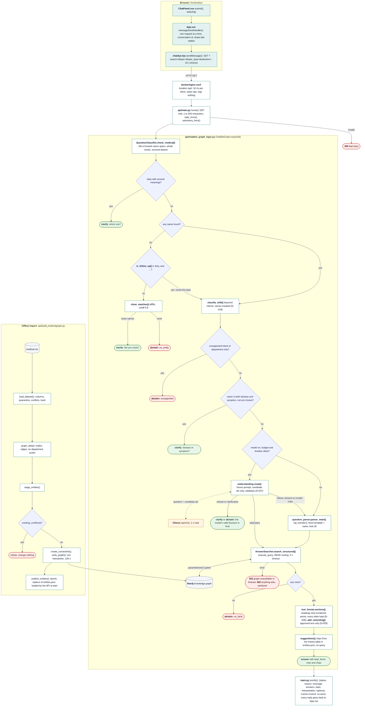

# FLOW

How execution travels. Update this when a path changes, and mark the functions a change touches.

## Software & System Design

Every path one question can take through the code, function by function, and the offline import that builds what the answers read. The text sections below give the same paths with more detail.



- **Colours:** pale teal for the browser code, white for functions, blue diamonds for decisions, grey for data, orange for the language model, green and red rounded boxes for the replies.
- **Replies:** each branch ends in its own rounded box, green for an answer or a clarifying question, red for an abstention or an error. `main.py` turns every one of them into the same JSON reply, which goes back to `App.vue`; the diagram draws that path once, from the answer.
- **Order of checks:** an ambiguous alias, then no name (follow-up or close matches), then an unsupported intent, then a name that is both disease and symptom, then the model, then the rules. The first check that decides ends the request.
- **The model never answers:** a valid model reply only picks (intent, candidate) pairs, which run the same fixed queries as the rules; a refusal or clarification is final; anything else falls back to the rules (D-027).
- **Errors:** the graph unavailable or a query timeout gives 503, anything else a sanitized 500; only the exception type is logged.

## A question (runtime)

```
frontend/src/components/ChatPanel.vue  submit() / ask(chip)   typed question, or a chip's question + choices + topic
  -> frontend/src/App.vue              messageSendHandler()   blocks duplicate submits; "New conversation" bumps the conversation id
  -> frontend/src/chatApi.mjs          sendMessage()          GET {base}/?search=&topic=&topic_type=&selection=name:type, 10 s timeout
  -> docker/nginx.conf                 location /api/         (Docker only; rate limit 10/s per client, strips /api, logs nothing)
  -> api/main.py                       home()                 empty and 500-char checks; topic_from(), selections_from() bound the extras
  -> api/chatbot_graph_logic.py        ChatBotGraph.respond()
       valid_topic()                   topic must be a dictionary name of that type
       classifier.check_medical()      Aho-Corasick entity spans, whole words only; sourced aliases map to their entry
       alias with several meanings     -> clarify which one
       is_follow_up()                  no entity + "it"/"and ..." and every other word is filler or an intent keyword -> reuse the topic
       close_matches()                 still no entity: offer up to 3 close names (difflib, cutoff 0.8) to confirm, never applied
       valid_selections()              clarification choices must name an entity in this question, with a type it really has
       classifier.classify_with()      keyword intents for the (now typed) entities, read with matched names masked (D-018)
       unsupported intent -> abstain   no database call
       department only    -> abstain   no database call
       disease and symptom -> clarify  options re-ask the original question with accumulated choices
       understanding.route()           D-027, when on: the typed names (or the topic, after is_follow_up) as candidates;
                                       budget and breaker allow -> Ollama /api/chat (2 s total); a valid answer -> one fixed
                                       query per (intent, subject) pair; a valid refusal or clarification is final;
                                       anything else -> the rules below, unchanged
  -> api/question_parser.py            parser_main() -> sql_transfer()   template + {name, limit: 20}
  -> api/answer_searcher.py            search_structured()    execute_query, READ routing, query timeout (5 s default); lead, items, note per subject
       text_format.sections()          long text: its own headings and numbered points, every letter kept (D-028)
       add_rewording()                 an approved rewording only on an exact input, output and formatter match (D-029)
       no rows -> abstain (no_facts)
       suggestions()                   from the intents table in entities.json (no query), only chips that classify back to their intent
  <- api/main.py                       jsonify({search, status, reason, message, answers, topic, interpretation, options})
  <- frontend                          bullets, chips for the latest reply, "Why this answer?", topic bar; a late reply after a reset is dropped
```

Errors: Neo4j unavailable, session expired or transaction timeout give 503 with a fixed message; anything else gives a sanitized 500. Only the exception type is logged.

## A graph import

```
api/build_medicalgraph.py main()
  -> load_dataset()        required columns, no unnamed rows, field-level quarantine, conflicting names excluded, source hash
  -> graph_data()          nodes and edges; skips self-complications, collapses repeated departments, refuses department cycles
  -> print_report()
  -> stage_entities()      entities.json written to a temp file
  -> existing_conflicts()  refuses if unowned data collides with the snapshot
  -> create_constraints()
  -> write_graph()         one transaction (120 s): delete owned snapshot, recreate it
  -> publish_entities()    os.replace of entities.json
```

## The MLOps gate

```
.github/workflows/mlops.yml -> data gate tests -> live tests (Neo4j 5, 4.4) -> import (Neo4j 5)
  -> scripts/evaluate_kg.py: integrity_checks() + evaluate() -> eval-report.json (counts and IDs only)
```

## A release

```
.github/workflows/autorelease.yml   (after automerge finishes, by hand, or by its own previous successful run)
  -> scripts/next_release.py        last published release on main; stop on a draft, version images without a release, or a failed lookup
                                    oldest first-parent commit after it that changed shipped files and has no published release
                                    none -> stop the chain; else its version (patch, its pull request's label, or the bump input)
                                    workflows changed after it -> release the first later commit whose workflows match main's,
                                    with every pending merge up to it, at their largest bump (D-034, BUG-004)
  -> release.yml (workflow_call, tag + sha)
       resolve   tag absent, sha on main, no release or version images
       backend, frontend, mlops at that sha
       images    pushed as sha-<sha>-<run_id>-<run_attempt>
       smoke     Compose smoke test of those digests
       publish   create the tag -> draft with assets -> version image tags -> publish -> start mirror.yml (a warning if that fails)
  -> continue (only after success)   gh workflow run autorelease.yml -> the next merge

.github/workflows/mirror.yml        (a separate run, started by publish or by hand with a tag; D-030)
  -> release published, final and passing; GHCR digests from its manifest.json
  -> per image on docker.io/hamzaazizai: same digest -> skip | other digest -> fail | confirmed absent -> skopeo copy --all --preserve-digests -> re-read and compare

.github/workflows/dockerhub-metadata.yml   (after every automerge run, or by hand; D-031)
  -> docs/dockerhub/ -> per repository: read Docker Hub -> patch only what differs (descriptions, immutable tags) -> read back
```

## A question on the hosted site (D-032)

```
browser --HTTPS--> Cloudflare edge (TLS ends; sets CF-Connecting-IP; /api/* bypasses the cache)
  -> tunnel -> cloudflared (10.213.0.2, keeps no logs) -> nginx (trusts CF-Connecting-IP only from 10.213.0.2)
       limits per visitor (10 r/s, burst 20) and 16 API requests in flight in total
  -> API (model through the stack's signed-in Ollama to its cloud, 6 calls a minute in total, D-033) -> Aura over neo4j+s (API driver limits: about 11 s to a 503 when unreachable)
```

## A hosted update (D-032)

```
medical-chatbot-update.timer (every 15 min) -> update_stack.py, hosted mode
  -> newer release with an unchanged compose.hosted.yaml -> site healthy? else wait
  -> pull -> stop cloudflared (public access closed; visitors see the maintenance page, D-035) -> stop web, api -> importer rebuilds the Aura graph
  -> up api, web (loopback) -> page, a question, /api/health ok -> up cloudflared -> record
  -> any failure: rebuild with the previous release's image -> checks -> reopen; if that fails, stay closed
```

## A readiness probe (D-022)

```
Docker healthcheck (every 30 s) or the stack updater  GET /health (via nginx: /api/health)
  -> api/main.py health()
  -> ChatBotGraph.ready()            the dictionary's disease count and CSV hash, read at start
  -> AnswerSearcher.readiness()      one READ, no retries, timeout <= 1 s: owned diseases, and those with the hash
  <- 200 {"status": "ok"} when both counts equal the dictionary's, else 503 {"status": "unavailable"}
```
